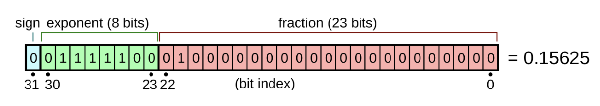
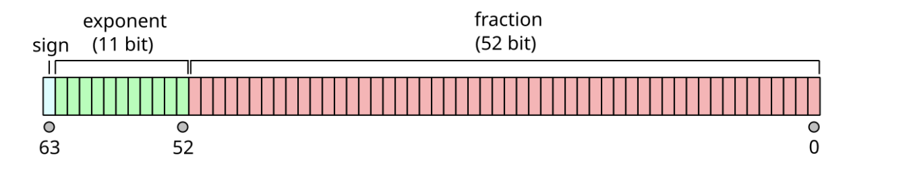

###### *Лекции по курсу "Основы программирования" МГТУ им. Баумана кафедра ИУ5*

# Лекция 2. Типы данных, переменные, операторы и условия

# Цели лекции

# План

## Первая часть

1. [Данные и память](#1-данные-и-память)
2. [Фундаментальные типы данных](#2-фундаментальные-типы-данных)
3. [Постоянные переменные (именованные константы)](#3-постоянные-переменные-именованные-константы)
4. [Литералы](#4-литералы)
5. [Переменные](#5-переменные)

----------

## Вторая часть

6. [Операторы](#5-операторы)
7. [Преобразование типов](#7-преобразование-типов)
8. [Условные конструкции](#8-условные-конструкции)
9. [Современный стиль программирования](#9-современный-стиль-программирования)
10. [namespace](#10-namespace)

----------

# 1. Данные и память

Программа — это последовательность инструкций.

Большинство программ работает с данными: хранит их, обрабатывает или передаёт.

Возникает вопрос:

**Где хранятся эти данные?**

Во время выполнения программы её данные могут храниться в регистрах процессора и различных областях памяти.

Можно представить память как большое количество ячеек.

```text
┬─────┬─────┬─────┬─────┬─────┬
|     |     |     |     |     |
┴─────┴─────┴─────┴─────┴─────┴
```

Каждая ячейка имеет свой адрес.

Программа помещает туда значения и затем читает их.

----------

## Почему существуют типы данных?

Компьютер хранит только биты.

```text
01010110
```

Но один и тот же набор битов можно трактовать по-разному.

Например

```text
01000001
```

может означать

- число 65;
- символ `'A'`;
- часть числа с плавающей точкой.

Для этого существуют типы данных.

*Тип данных* определяет, какие значения может представлять объект, как эти значения представлены и какие операции над ними допустимы.

----------

# 2. Фундаментальные типы данных

Основные категории.
[]https://cppreference.com/cpp/language/types

----------

## Тип `void`

`void` — специальный тип, обозначающий отсутствие значения. Например, функция с типом `void` не возвращает значение.

Подробно будет рассмотрен позже при изучении функций.

## Стандартные целочисленные типы

**`int`** — базовый целочисленный тип.

Используются для хранения целых чисел.

Например

```cpp
int age{20};
int year = 2026;
```

Ключевое слово `int` может быть опущено, если используются какие-либо из перечисленных ниже модификаторов. Если модификаторы длины отсутствуют, гарантируется ширина не менее 16 бит.

На большинстве современных настольных платформ int занимает 4 байта.

**Модификаторы**

Изменяют базовый целочисленный тип. Может быть смешан в любом порядке. В имени типа может присутствовать только один представитель каждой группы.

**`signed`** — знаковый целочисленный тип (это значение по умолчанию, если оно опущено).
**`unsigned`** — беззнаковый целочисленный тип

Размер:

**`short`** — целочисленный тип размером не менее 16 бит.
**`long`** — целочисленный тип размером не менее 32 бит.

**`long long`** — целочисленный тип размером не менее 64 бит.

**Расширенные целочисленные** типы определяются реализацией. Следует отметить, что [целочисленные типы фиксированной ширины](https://cppreference.com/cpp/types/integer) обычно являются псевдонимами стандартных целочисленных типов.

----------

## Логический тип

**`bool`** — логический тип, способный хранить одно из двух значений: `true` или `false`.

```cpp
bool isReady{true};
```

----------

## Символьный тип

`char` — однобайтный целочисленный тип, который обычно используется для хранения символов.

```cpp
char grade{'A'};
```

`signed char` и `unsigned char` — знаковая и беззнаковая разновидности `char`, используемые как целочисленные типы.

`char` — тип для представления символов ( 1 байт)
`wchar_t` — тип для широких символов; его размер зависит от платформы.

**Расширенные** типы для представления символов UTF-8, UTF-16, UTF-32 -кодированных последовательностей соответственно `char8_t` *(начиная с C++20)*; `char16_t`, `char32_t` *(начиная с C++11)*

>ВАЖНО
>
> символ — это не строка.

----------

## Типы с плавающей запятой

`float` — Тип с плавающей точкой одинарной точности. Обычно [в формате IEEE-754 binary32](https://en.wikipedia.org/wiki/Single-precision_floating-point_format) .



Используются для хранения дробных значений.

```cpp
float middlePoint{1.5625f};
```

`double` — Тип с плавающей точкой двойной точности. Обычно используется [формат IEEE-754 binary64](https://en.wikipedia.org/wiki/Double-precision_floating-point_format) .



`long double` — Тип данных с плавающей запятой расширенной точности.
Не обязательно соответствует типам, предписанным стандартом IEEE-754.

Типы с плавающей точкой используются для хранения дробных значений.

```cpp
double pi{3.1415926535};
```

----------

## Размеры типов

Размер зависит от платформы и компилятора.

Нельзя писать `int` всегда 4 байта. Это неверно.

Правильно использовать `sizeof(int)`

Например

```cpp
std::cout << sizeof(double);
```

----------

## sizeof

`sizeof` — оператор, который возвращает размер типа или объекта в байтах.

```cpp
int x{1};

std::cout << sizeof(int);
std::size_t n = sizeof(int);

std::cout << sizeof(x);
```

Важно: `sizeof` возвращает значение типа `std::size_t`.
Точное определение зависит от компилятора и стандартной библиотеки.

Например, в GCC на Linux `std::size_t` обычно в конечном итоге соответствует `unsigned long`, но полагаться именно на это соответствие в переносимом C++ коде не следует.

----------

# 3. Постоянные переменные (именованные константы)

В программировании константа — это значение, которое не может быть изменено во время выполнения программы.

В C++ поддерживаются два разных типа констант:

- ***Именованные константы*** — это постоянные значения, связанные с идентификатором. Их также иногда называют символическими константами .

- ***Литеральные константы*** — это постоянные значения, не связанные с идентификатором.

## Типы именованных констант

В C++ существует три способа определения именованной константы:

- ***Постоянные переменные*** (рассматриваются на этой лекции).

- ***Макросы, подобные объектам, с подстановочным текстом*** (представлены в лекции — *Введение в препроцессор*).

- ***Перечисляемые константы*** (будут рассмотрены на лекции *Перечисления без области видимости*).

***Константные переменные*** — это наиболее распространенный тип именованных констант.

Для объявления константной переменной мы помещаем `const` ключевое слово (называемое «квалификатором const») рядом с типом объекта:

```cpp
const double gravity { 9.8 };
int const sidesInSquare { 4 };
```

Несмотря на то, что язык C++ позволяет размещать `const` как перед типом данных, так и после него, хорошей практикой считается размещать `const` перед типом данных.

>***Константные переменные должны быть инициализированы.***
Объявление константы без её инициализации вызовет ошибку компиляции

Константные переменные могут быть инициализированы другими переменными (включая неконстантные):

```cpp
#include <iostream>

int main(){
    std::cout << "Enter your age: ";
    int age{};
    std::cin >> age;

    const int constAge { age }; // Инициализировать константную переменную с использованием неконстантного значения
    age = 5;      // ok: age является неконстантным
    constAge = 6; // error: constAge является константой, поэтому мы не можем изменить её значение

    return 0;
}
```

Для константных переменных используется несколько различных соглашений об именовании.

Программисты, перешедшие с C, часто предпочитают использовать подчеркивания и заглавные буквы для имен константных переменных (например, `EARTH_GRAVITY`). В C++ чаще используются имена с префиксом 'k' (например `kEarthGravity`).

Однако, поскольку константные переменные ведут себя как обычные переменные (за исключением того, что им нельзя присваивать значения), нет причин для необходимости в специальном соглашении об именовании. По этой причине можно использовать то же соглашение об именовании, которое мы используем для неконстантных переменных (например, `earthGravity`).

### Время компиляции и время выполнения

Процесс компиляции программы это ***время компиляции*** (`compile time`). Компилятор проверяет вашу программу на синтаксические ошибки и, если их нет, конвертирует код в объектные файлы.

Временной промежуток с момента старта выполнения программы и до момента окончания её работы называется ***временем выполнения*** программы (`runtime`).

### Спецификатор `constexpr`

В языке C++ есть два вида констант:

- Константы *времени выполнения*. Их значения определяются только во время выполнения программы. Переменная `constAge` выше является константой *времени выполнения*, так как компилятор не может определить её значение во время компиляции. `constAge` зависит от пользовательского ввода (который можно получить только во время выполнения программы).

- Константы *времени компиляции*. Их значения определяются во время компиляции программы. Например, переменная со значением силы тяжести на Земле является константой времени компиляции, так как мы её определяем во время написания программы (до начала её выполнения).

В большинстве случаев не важно какой тип константы вы используете: времени выполнения или времени компиляции. Однако, все же есть несколько ситуаций, когда C++ может потребовать константу времени компиляции вместо времени выполнения. Так как есть 2 типа констант, то компилятору нужно постоянно отслеживать, к какому из них относится какая переменная. Чтобы упростить это задачу, в C++11 добавили спецификатор constexpr, который сообщает компилятору, что текущая переменная является константой времени компиляции:

```cpp
constexpr double gravity {9.8}; // ок, значение определяется во время компиляции программы
constexpr int sum {4 + 5}; // ок, результат выражения 4 + 5 определяется во время компиляции программы

std::cout << "Enter your age: ";
int age{};
std::cin >> age;
constexpr int myAge { age }; // неправильно, переменная age не определяется во время компиляции программы
```

>***Правило: Любая переменная, которая не должна изменять свое значение после инициализации, должна быть объявлена с помощью спецификатора const (или constexpr).***

----------

# 4. Литералы

***Литералы*** — это значения, которые вставляются непосредственно в код.

```cpp
    return 5;                     // 5 целочисленный литерал
    bool myNameIsAlex { true };   // true булевым(логическим) литералом
    double d { 3.4 };             // 3.4 литерал с плавающей точкой типа double
    std::cout << "Hello, world!"; // "Hello, world!" является строковым литералом в стиле Си
```

Иногда литералы называют литеральными константами , потому что их значение нельзя переопределить ( 5 всегда означает целое значение 5).

| Буквальное значение | Примеры | Тип литерала по умолчанию | Примечание |
| :--- | :--- | :--- | :--- |
| Целочисленное значение | `5`, `0`, `-3` | `int` | целочисленный литерал |
| Логическое значение | `true`, `false` | `bool` | булевый(логический) литерал |
| Значение с плавающей запятой | `1.2`, `0.0`, `3.4` | `double` | В C++ по умолчанию используется double, а не float |
| Символьное значение (Character) | `'a'`, `'\n'` | `char` | символьный литерал. Всегда в одинарных кавычках |
| Строка в стиле C (C-style string) | `"Hello, world!"` | `const char[14]` | строковый литерал. Включает скрытый нулевой символ `\0` в конце |

### Литеральные суффиксы

Тип литерала по умолчанию можно изменить, добавив суффикс. Вот некоторые из наиболее распространенных суффиксов:

| Тип данных | Суффикс | Значение | Примечание |
| :--- | :--- | :--- | :--- |
| Целочисленный | `u`, `U` | `unsigned int` | Беззнаковое целое число |
| Целочисленный | `l`, `L` | `long` | Длинное целое число |
| Целочисленный | `ul`, `UL`, `lu`, `LU` | `unsigned long` | Беззнаковое длинное целое число |
| Целочисленный | `ll`, `LL` | `long long` | Очень длинное целое число |
| Целочисленный | `ull`, `ULL`, `llu`, `LLU` | `unsigned long long` | Беззнаковое очень длинное целое число |
| Целочисленный | `z`, `Z` | Знаковая версия `std::size_t` | Добавлено в C++23 (тип `std::ptrdiff_t`) |
| Целочисленный | `uz`, `UZ`, `zu`, `ZU` | `std::size_t` | Добавлено в C++23 (размер объектов в памяти) |
| С плавающей запятой | `f`, `F` | `float` | Число с плавающей запятой одинарной точности |
| С плавающей запятой | `l`, `L` | `long double` | Число с плавающей запятой расширенной точности |

В большинстве случаев суффиксы не требуются (за исключением `f`).

### Целочисленные литералы

```cpp
#include <iostream>

int main(){
    std::cout << 5 << '\n';  // 5
    std::cout << 5L << '\n'; // 5L тип long
    std::cout << 5u << '\n'; // 5u is тип unsigned int

    return 0;
}
```

### Литералы с плавающей запятой

По умолчанию литералы с плавающей запятой имеют тип `double`. Чтобы преобразовать их `float` в литералы, следует использовать суффикс `f`( или `F` ):

```cpp
#include <iostream>

int main(){
    std::cout << 5.0 << '\n';  // тип double (по умолчанию)
    std::cout << 5.0f << '\n'; // 5.0f тип float

    return 0;
}
```

```cpp
float f { 4.1 }; // ошибку компиляции (narrowing conversion error) 4.1 is a double literal, not a float literal
```

Поскольку `4.1` у него нет суффикса, литерал имеет тип `double`, а не `float`. Когда компилятор определяет тип литерала, ему всё равно, что вы с ним делаете (например, в данном случае, используете его для инициализации `float` переменной). Поскольку тип литерала (`double`) не совпадает с типом переменной, для инициализации которой он используется ( `float`), значение литерала необходимо преобразовать в тип `float`, чтобы затем использовать его для инициализации переменной `f`. Преобразование значения из типа `double` в тип `float` может привести к потере точности, поэтому компилятор выдаст предупреждение.

В данном случае решение одно из следующих:

```cpp
float f { 4.1f };
double d { 4.1 };
```

### Научная нотация для литералов с плавающей запятой

Существует два разных способа записи литералов с плавающей запятой.

- В стандартной записи число записывается с десятичной точкой:

```cpp
double pi { 3.14159 };
double d { -1.23 };
double why { 0. };
```

- В научной нотации для обозначения показателя степени добавляется символ `e`:

```cpp
double avogadro { 6.02e23 };
double protonCharge { 1.6e-19 };
```

### Строковые литералы

В программировании строка — это набор последовательных символов, используемых для представления текста (например, имен, слов и предложений).

```cpp
#include <iostream>

int main(){
    std::cout << "Hello, world!";
    return 0;
}
```

`"Hello, world!"` Это строковый литерал. Строковые литералы заключаются в двойные кавычки, чтобы обозначить их как строки (в отличие от символьных литералов, которые заключаются в одинарные кавычки).

Поскольку строки широко используются в программах, большинство современных языков программирования включают в себя базовый строковый тип данных. По историческим причинам строки не являются базовым типом в C++. Вместо этого у них есть странный, сложный тип, с которым трудно работать (Лекция 8). Такие строки часто называют С-строками  или строками в стиле C, поскольку они унаследованы от языка C.

Есть две неочевидные вещи, которые стоит знать о строковых литералах в стиле C.

- Все строковые литералы в стиле C имеют неявный нулевой терминатор `'\0'`. Рассмотрим строку, например, такую "hello": . Хотя эта строка в стиле C кажется состоящей всего из пяти символов, на самом деле в ней их шесть: `'h'`, `'e'`, `'l'`, `'l'`, `'o'`, и `'\0'`(символ с кодом ASCII 0). Этот завершающий символ `'\0'` является специальным символом, называемым нулевым терминатором , и используется для обозначения конца строки. Строка, заканчивающаяся нулевым терминатором, называется строкой с нулевым терминатором.

- В отличие от большинства других литералов (которые являются значениями, а не объектами), строковые литералы в стиле C являются константными объектами, которые создаются в начале программы и гарантированно существуют на протяжении всей программы.

### Магические числа

Магическое число — это литерал (обычно число), который либо имеет неясное значение, либо может потребовать изменения в дальнейшем.

Вот два утверждения, демонстрирующие примеры «магических чисел»:

```cpp
const int maxStudentsPerSchool{ numClassrooms * 30 };
setMax(30);
```

Что означают литералы 30 в этих контекстах? В первом случае, вероятно, можно догадаться, что это количество студентов в классе, но это не сразу очевидно. Во втором случае — кто знает. Нам нужно будет посмотреть на функцию, чтобы понять, что она делает.

В сложных программах очень трудно понять, что означает тот или иной литерал, если нет поясняющего комментария.

Использование «магических чисел» обычно считается плохой практикой, поскольку, помимо отсутствия контекста относительно того, для чего они используются, они создают проблемы, если значение необходимо изменить. Предположим, необходимо увеличить количество с 30 до 35, и наша программа должна это отражать.

Для этого нам нужно обновить один или несколько литералов с 30 на 35. Но какие именно? Литерал 30 в инициализаторе `maxStudentsPerSchool` кажется очевидным. Но как насчет литерала, используемого в качестве аргумента для `setMax()`? Имеет ли он то же значение, что и другие 30? Если да, то его следует обновить. Если нет, то его следует оставить как есть, иначе мы можем сломать нашу программу где-то еще. При глобальном поиске и замене можно случайно обновить аргумент, `setMax()` когда он не должен был меняться. Поэтому приходится просматривать весь код на наличие каждого экземпляра литерала 30 (которых могут быть сотни), а затем индивидуально определять, нужно ли его менять или нет. Это может отнимать очень много времени (и чревато появлением новых ошибок).

Проблемы с обновлением легко решаются с помощью символических констант:

```cpp
constexpr int maxStudentsPerClass { 30 };
const int totalStudents{ numClassrooms * maxStudentsPerClass };

constexpr int maxNameLength{ 30 };
setMax(maxNameLength);
```

Название константы задаёт контекст, и достаточно обновить значение только в одном месте, чтобы внести изменения во всю программу.

Обратите внимание, что магические числа не всегда являются числами — они также могут быть текстом (например, именами) или другими типами данных:

```cpp
int main(){
    ...
    printAppWelcome("MyCalculator"); // bad: имя приложения может использоваться в других местах или измениться в будущем
    ....
}
```

Литералы, используемые в очевидных контекстах, которые вряд ли изменятся, обычно не считаются магическими. Значения `-1`, `0`, `0.0`, и `1` часто используются.

>***Избегайте использования «магических чисел» в коде (вместо них используйте constexpr-переменные)***

----------

# 5. Переменные

```cpp
int age{20};
```

- **Объявление** - сообщает компилятору о существовании сущности.
- **Определение** - создаёт сущность и, для объекта, обычно выделяет необходимое место для хранения.
- **Инициализация** - задаёт начальное значение объекта.

----------

## Идентификаторы

Правила именования.

Можно

```cpp
studentAge
```

Нельзя

```cpp
2age
```

или

```cpp
int
```

как имя переменной.

----------

## Хорошие имена

Плохо

```cpp
int a;
```

Хорошо

```cpp
int studentAge;
```

----------

## Объявление

```cpp
int value;
```

Локальная переменная, объявленная без инициализатора, не получает автоматически значение `0`. Использование её значения до инициализации приводит к неопределённому поведению.

----------

## Инициализация

Современный стиль

```cpp
int value{10};
```

----------

Другой допустимый способ

```cpp
int value = 10;
```

тоже работает, но на курсе будем использовать инициализацию фигурными скобками.

----------

## Почему фигурные скобки?

Они предотвращают часть ошибок.

Например

```cpp
int x{3.7};
```

Компилятор сообщит об ошибке,

поскольку происходит сужающее преобразование.

А запись

```cpp
int x = 3.7;
```

скомпилируется, но значение станет равным `3`.

----------

## Константы

Иногда значение не должно изменяться. Используется `const`

```cpp
const double Pi{3.141592653589793};
```

Попытка изменить значение приведет к ошибке компиляции.

----------

# Перерыв

----------

# 6. Операторы

## Арифметические

```cpp
+
-
*
/
%
```

оператор `%` работает только для целых чисел.

----------

## Приоритет операций

Как и в математике.

```cpp
*
/
```

выполняются раньше

```cpp
+
-
```

При необходимости использовать скобки.

----------

## Операции присваивания

```cpp
=
+=
-=
*=
/=
%=
```

----------

## Инкремент и декремент

```cpp
++
--
```

`++c;` префиксной → сначала прибавить, потом использовать

и

`c++;` постфиксной формой → сначала использовать, потом прибавить.

```cpp
int c{5};

int a{++c}; // c = 6, a = 6
int b{c++}; // b = 6, c = 7
```

----------

## Операции сравнения

```cpp
==
!=
<
>
<=
>=

```

Результат — тип `bool`

## Логические операции

```cpp
&& —    И   → оба условия должны быть true
|| —    ИЛИ → хотя бы одно условие должно быть true
! —     НЕ  → переворачивает значение
```

----------

# 7. Преобразование типов

## Неявное

```cpp
double x{5};
```

Целое число автоматически преобразуется к типу `double`.

----------

## Явное

C-style преобразование

```cpp
(double)x

```

Современный стиль

```cpp
static_cast<double>(x)
```

явно показывает намерение программиста выполнить преобразование.

----------

# 8. Условные конструкции

Иногда программа должна принимать решение.

Используются условные операторы.

----------

## if

```cpp
if (age >= 18)
{
    std::cout << "Совершеннолетний";
}
```

----------

## if...else

```cpp
if (number % 2 == 0) {
        std::cout << "Число четное.\n"l;
    } else {
        std::cout << "Число нечетное.\n";
    }
```

----------

## else if

Для нескольких вариантов.

----------

## switch

Используется,

когда необходимо выбрать один из нескольких фиксированных вариантов.

```cpp
switch (day) {
    case 1:
        std::cout << "Monday";
        break;
    case 2:
        std::cout << "Tuesday";
        break;
    default:
        std::cout << "Unknown";
}
```

----------

## Тернарный оператор

```cpp
int max{(a > b) ? a : b};
```

Компактная запись простого `if...else`.

----------

# 9. Современный стиль программирования

На протяжении курса необходимо придерживаться следующих правил:

- использовать фигурную инициализацию;
- применять `const`, если значение не изменяется;
- избегать магических чисел;
- использовать понятные имена переменных;
- отдавать предпочтение `static_cast`, а не C-style cast;
- не писать сложные условия без необходимости;
- форматировать код единообразно.

----------

# 10. Namespace

<!--<p style="text-align: right; font-size: 0.8em;"-->
###### *Этот раздел необходим для правильного выполнения лабораторной работы № 1*
<!--</p>-->

- 10.1.  **Проблема конфликтов имён**.
- 10.2.  **Обычный `namespace`**.
- 10.3.  **`std` как namespace**.
- 10.4.  **Anonymous namespace**.
- 10.5.  **Связь с лабораторной**.

#### 1. Проблема конфликтов имён

```cpp
const int kMaxValue{100};

const int kMinValue{0};

int main(){

    // ...

}
```

> Где находятся эти константы?

Здесь появляется понятие **глобальной области видимости**.

> Сейчас `kMaxValue` и `kMinValue` объявлены в глобальной области видимости. Это значит, что их имя находится на уровне всего исходного файла и потенциально может конфликтовать с другими именами.

Например:

```cpp
const int kMaxValue{100};
```

// где-нибудь в другом месте программы

```cpp
const int kMaxValue{1000};
```

В реальном большом проекте имён становится очень много. Поэтому возникает проблема:

> **Как организовать имена так, чтобы они не конфликтовали между собой?**

Для этого используется `namespace`.

----------

#### 2. Обычный namespace

```cpp
namespace Limits{

    const int kMaxValue{100};

    const int kMinValue{0};

}
```

Теперь эти имена находятся не просто в глобальной области, а внутри пространства имён `Limits`.

Использовать их можно через `::`:

```cpp
int main(){

    int value{50};
    if (value > Limits::kMaxValue){

        // ...

    }
    return 0;
}
```

> `::` называется оператором разрешения области видимости — **scope resolution operator**.

То есть: `Limits::kMaxValue` можно читать примерно как:

> «возьми `kMaxValue`, который находится внутри `Limits`».

----------

#### 3. Зачем вообще это нужно

Можно показать два разных пространства имён:

```cpp
namespace Physics{
    const double PI{3.14159};
}

namespace Geometry{
    const double PI{3.14};
}
```

Теперь никаких проблем:

```cpp
double a{Physics::PI};

double b{Geometry::PI};
```

У нас существуют два разных `PI`:

`Physics::PI`

`Geometry::PI`

Имена одинаковые, но они находятся в разных пространствах имён.

> **Namespace позволяет логически группировать имена и избегать конфликтов имён.**

----------

#### 4. Связь с `std`

`std::cout`

`std::cin`

> А что такое `std`?

Это тоже пространство имён.

Например:

`std::cout << "Hello";`

означает, что мы обращаемся к объекту `cout`, находящемуся в namespace `std`.

----------

#### 5. Anonymous namespace

```cpp
namespace{
    const int kMaxValue{100};
    const int kMinValue{0};
}
```

>Это **анонимное пространство имён** — anonymous namespace.

У него нет имени:

```cpp
namespace{

    // ...

}
```

Поэтому обратиться к `kMaxValue` через какое-то имя namespace невозможно:

// такого имени пространства имён нет.

`???::kMaxValue`

Использование происходит просто по имени:

```cpp
int main(){

    int value{50};

    if (value > kMaxValue){

        // ...

    }
    return 0;
}
```

----------

#### 6. Но зачем тогда anonymous namespace?

> Представим, что эти константы нужны только этому исходному файлу. Мы не хотим использовать их как часть интерфейса программы и не хотим, чтобы их имена использовались где-то ещё.

Тогда:

```cpp
namespace{
    const int kMaxValue{100};
    const int kMinValue{0};
}
```

> **Эти имена предназначены для использования внутри данного исходного файла.**

> Более точно, объекты, объявленные в anonymous namespace, получают внутреннее связывание. К этому понятию мы ещё вернёмся, когда будем разбирать, как компилятор работает с несколькими исходными файлами.

----------

#### 7. Почему это лучше, чем просто глобальная переменная?

#### Просто глобальная область

```cpp
    const int kMaxValue{100};
    const int kMinValue{0};
```

#### Anonymous namespace

```cpp
namespace{
    const int kMaxValue{100};
    const int kMinValue{0};
}
```

> В обоих случаях внутри этого `.cpp` файла мы можем написать просто `kMaxValue`. Но anonymous namespace явно показывает: эти имена являются частью внутренней реализации этого исходного файла и не предназначены для использования как внешние имена.

Это особенно хорошо ложится на будущую тему **инкапсуляции и организации кода**.

----------

#### 8. Важный момент: namespace ≠ область видимости функции

```cpp
namespace Constants{
    const int kMaxValue{100};
}

int main(){

    int value{50};

    if (value < Constants::kMaxValue){

        int result{value * 2};

    }

    // result здесь недоступен

    return 0;

}
```

`namespace` и область видимости переменной — связанные, но разные понятия.

> Namespace — это механизм организации имён.
> Область видимости определяет, где конкретное имя можно использовать.

Подробно различие между **scope, linkage и lifetime** будет рассмотрено позже.

Подробно различие между **scope** (областью видимости), **linkage** (связыванием) и **lifetime** (временем жизни) будет рассмотрено позже.

----------

#### 9. Небольшая связь с лабораторной

> В лабораторной вы будете использовать константы, которые необходимо определять в anonymous namespace. **Удалять namespace или переносить эти константы в `main` не нужно.**
>
> Ваша задача — использовать в своей программе константы вместо магических чисел.

----------
