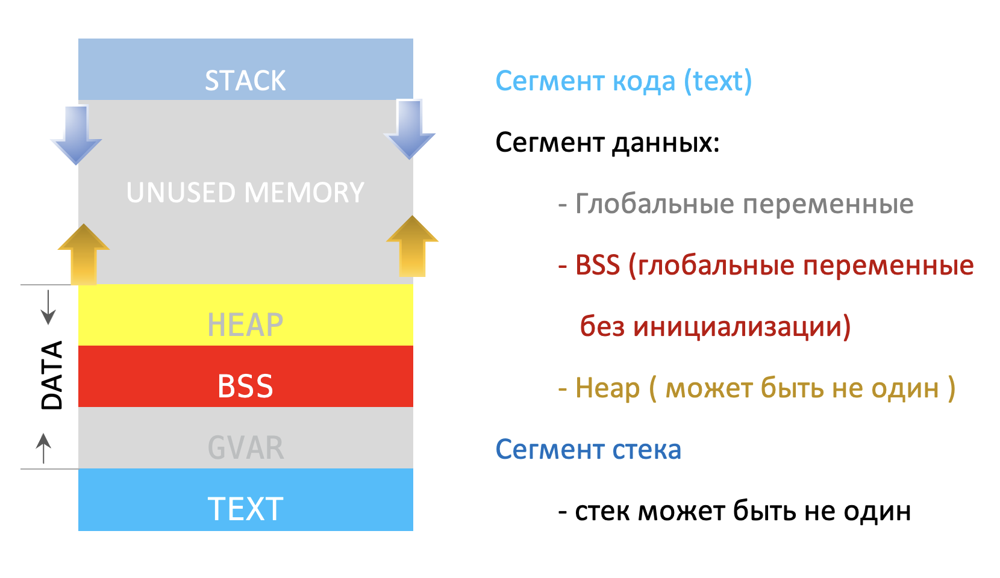

###### *Лекции по курсу "Основы программирования МГТУ им. Баумана кафедра ИУ5"*

# Лекция 7. Массивы и продолжение указателей

**Курс:** Основы программирования на C++
**Продолжительность:** 2 × 45 минут

# План лекции

## Первая часть — 45 минут

1. [Проблема масштабируемости переменных](#1-проблема-масштабируемости-переменных)
2. [Массивы](#2-массивы)
   - [Объявление массива](#объявление-массива)
   - [Агрегированная инициализация массивов](#агрегированная-инициализация-массивов)
   - [Получение длины массива](#получение-длины-массива)
   - [Цикл range-based for](#цикл-range-based-for)
   - [Передача массива в функцию](#передача-массива-в-функцию)

## Вторая часть — 45 минут

   - [Адрес нулевого элемента](#адрес-нулевого-элемента)
   - [Перебор массива через указатель](#перебор-элементов-массива)
   - [`const` и указатели](#const-и-указатели)
3. [Устройство памяти процессора](#3-устройство-памяти-процессора)
   - [Как устроен и работает Стек](#как-устроен-и-работает-стек)

----------

# Первая часть — массивы

## 1. Проблема масштабируемости переменных

Рассмотрим ситуацию, когда нам нужно записать результаты тестов 26 студентов и рассчитать средний балл по группе. Для этого нам потребуется 26 переменных. Мы можем определить их следующим образом:

```cpp

    int testScore1 {};
    int testScore2 {};
    int testScore3 {};
    // ...
    int testScore26 {};
```

Нужно определить очень много переменных! А чтобы рассчитать средний балл, нам нужно будет сделать что-то подобное:

```cpp
int average { (testScore1 + testScore2 + testScore3 + testScore4 + testScore5
     + testScore6 + testScore7 + testScore8 + testScore9 + testScore10
     + testScore11 + testScore12 + testScore13 + testScore14 + testScore15
     + testScore16 + testScore17 + testScore18 + testScore19 + testScore20
     + testScore21 + testScore22 + testScore23 + testScore24 + testScore25
     + testScore26) / 26; };
```

Это не только требует много ввода текста, но и очень монотонно (и допустить опечатку в одном из чисел несложно, даже не заметив этого). А если мы захотим что-то сделать с каждым из этих значений (например, вывести их на экран), нам придётся заново вводить имена каждой из этих переменных.

Теперь предположим, что нам нужно изменить нашу программу, чтобы учесть еще одного студента, который только что был добавлен в группу. Нам придется просканировать весь код и вручную внести `testScore31` необходимые изменения. Любое изменение существующего кода сопряжено с риском появления новых ошибок. Например, несложно забыть обновить делитель при вычислении среднего значения с 26 на 27!

И это всего лишь при наличии 26 переменных. Рассмотрим случай, когда у нас сотни или тысячи объектов. Когда нам нужно больше нескольких объектов одного типа, определение отдельных переменных просто не масштабируется.

Нужна структура, которая позволяет хранить много однотипных объектов.  -> **Массив**

## 2. Массивы

### Объявление массива

`ТИП-элементов-массива ИМЯ-массива [РАЗМЕР-массива];`

```cpp
int testScore[25];
```

```text
testScore
┌────┬────┬────┬         ┬───┬────┐
│    │    │    │             │    │
└────┴────┴────┴         ┴───┴────┘
  0    1    2             23    24
```

Каждый элемент имеет свой индекс.

Индексация начинается с нуля.

Размер массива представляет собой `const` целочисленное значение типа, указывающее компилятору, сколько элементов находится в массиве.
Размер массива должн быть не менее 1. Компилятор выдаст ошибку, если длина массива равна нулю, отрицательному значению или нецелому числу.

### Агрегированная инициализация массивов

```cpp
    int fibonnaci[6] = { 0, 1, 1, 2, 3, 5 };
    int prime[5] { 2, 3, 5, 7, 11 };
    int arr2[5] {}; // инициализация всех элементов массива значением 0
```

```cpp
    int a[4] { 1, 2, 3, 4, 5 }; // error компиляции: слишком много инициализаторов
    int b[4] { 1, 2 };          // okey; b[2] and b[3] инициализированы значением 0
    int bad[] {};               // error компиляции: компилятор определит это как массив нулевой длины, что недопустимо!
```

### Получение длины массива

```cpp
    const int array[] { 2, 3, 5, 7, 11 };

    std::cout << "Размер массива: " << sizeof(array) << " байт\n";

    std::cout << "Массив содержит: " << sizeof(array) / sizeof(array[0]) << " элементов\n";
```

### Массивы в стиле C не поддерживают присваивание

```cpp
int arr[] { 1, 2, 3 };
    arr[0] = 4;
    arr = { 5, 6, 7 };     // error компиляции: Недопустимое присваивание массива
```

### Перебор массива

```cpp
int array[]{10, 20, 30, 40, 50};
std::size_t n {sizeof(array) / sizeof(int)};

for (std::size_t i{0}; i < n; ++i){
    std::cout << array[i] << '\n';
}
```

> `std::size_t` — стандартный беззнаковый целочисленный тип, который обычно используют для размеров и индексов.

### Цикл range-based for

Современный C++ позволяет писать проще:

```cpp
int array[]{10, 20, 30, 40};

for (int element : array){
    std::cout << element << '\n';
}
```

> Для каждого элемента(element) массива взять его значение в `array`.

### Изменение элементов

```cpp
int arr[]{1, 2, 3, 4};

for (int& element : arr)
{
    element *= 2;
}
```

в массиве теперь:

```text
2 4 6 8
```

без ссылки:

`element` был бы копией элемента.

### `const` при переборе

Если массив менять не нужно:

```cpp
for (const int& element : arr)
{
    std::cout << element << '\n';
}
```

```text
int
    ↓
копия

const int&
    ↓
ссылка без изменения
```

### Выход за границы массива

```cpp
int massiv[5];
```

Допустимые индексы:

```text
0 1 2 3 4
```

>***C++ не проверяет выход за пределы границ массива во время выполнения.***

Можно написать:

```cpp
massiv[5] = 100;
```

Это ошибка.

Причем компилятор не обязан остановить программу.

Происходит обращаение к памяти за пределами массива.

Это ***неопределенное поведение***.

Программа может:

- случайно работать;
- вывести неправильное значение;
- изменить другую переменную;
- завершиться аварийно;
- проявить ошибку гораздо позже.

### Передача массива в функцию

Можно написать:

```cpp
void printArray(int arr[], std::size_t size)
{
    for (std::size_t i{0}; i < size; ++i)
    {
        std::cout << arr[i] << ' ';
    }
}

int main(){
    int array[]{10, 20, 30, 40};

    printArray(array, sizeof(array)/sizeof(int));

    return 0;
}
```

В параметрах функции массив фактически корректируется в тип указателя.

```cpp
void printArray(int* arr, std::size_t size);
```

```text
array
   ↓
доступ к нулевому элементу

size
   ↓
количество элементов
```

<!--Но пока наша задача — понять фундаментальные механизмы языка.-->

### Функция изменения массива

```cpp
void doubleValues(int arr[], std::size_t size)
{
    for (std::size_t i{0}; i < size; ++i)
    {
        arr[i] *= 2;
    }
}

int main(){
    int array[]{1, 2, 3, 4};

    doubleValues(array, sizeof(array)/sizeof(int));

    return 0;
}
```

После:

```text
2 4 6 8
```

----------

# Вторая часть

### Адрес нулевого элемента

```cpp
int array[]{10, 20, 30, 40};
```

Адрес нулевого элемента:

```cpp
&array[0]
```

Имя массива в *большинстве* выражений преобразуется в указатель на первый элемент.

Поэтому: `array` в соответствующем контексте представляет адрес первого элемента.

Если сравнить:

```cpp
array
```

и:

```cpp
&array[0]
```

Оба выражения указывают на нулевой элемент массива.

### Но массив — НЕ указатель

Это принципиально.

Нельзя говорить:

> «Массив — это указатель».

Правильнее:

> **В большинстве выражений имя встроенного массива преобразуется в указатель на его нулевой элемент.**

Например:

```cpp
int array[3];
```

и:

```cpp
int* ptr;
```

— это разные типы.

Массив содержит свои элементы.

Указатель хранит адрес.

### НО

```cpp
int arr[]{10, 20, 30};

int* ptr{arr};

std::cout << *ptr << '\n';  //10
```

Потому что:

```text
arr
   ↓
адрес arr[0]

ptr
   ↓
тот же адрес

*ptr
   ↓
array[0]
```

### Перебор элементов массива

```cpp
    int arr[]{10, 20, 30, 40};

    int* ptr{arr};

    std::cout << *ptr;      // 10

    ++ptr;

    std::cout << *ptr;      // 20

    ++ptr;                  // указывает на 30
```

> **Арифметика указателей выполняется в единицах элементов указанного типа.**

<!-- И даже `i[array]`

`array[i]` и: `i[array]` имеют одинаковый смысл.

Потому что определение индексирования связано с:

```cpp
*(array + i)
```

а сложение коммутативно: `array + i` и: `i + array`

> Так писать в обычном коде не надо. Это демонстрация того, как работает оператор `[]`.
-->

### Перебор массива через указатель

Существует два классических способа обхода массива через явный указатель:

- ***Сдвиг индекса (смещение относительно базы)***

```cpp
const int n{4};
int array[]{10, 20, 30, 40};

int* ptr{array};

for (std::size_t i{0}; i < n; ++i){
    std::cout << *(ptr + i) << '\n';    // array[i]
}
```

- ***Способ 2: Инкремент самого указателя***

```cpp
const int n{4};
int array[]{10, 20, 30, 40};

int* ptr{array};

for (std::size_t i{0}; i < n; ++i){
    std::cout << *ptr << '\n';
    ++ptr;     // Здесь указатель последовательно перемещается по массиву
}
```

### Сравнение оператора sizeof (array vs ptr)

```cpp
int array[]{10, 20, 30, 40};

int* ptr{array};

std::cout << sizeof(array) << '\n';     // 16
std::cout << sizeof(ptr) << '\n';       // 4 или 8(зависит от архитектуры)
```

Конкретные размеры зависят от платформы и типов.

### `const` и указатели

Позиция ключевого слова `const` в объявлении указателя кардинально меняет правила константности для адреса и самих данных.

- ***Указатель на константу (Pointer to constant)***

```cpp
const int* ptr;     // указатель на const int

*ptr = 10;  // error: через него нельзя изменить int:
```

Но сам указатель можно переназначить:

```cpp
ptr = &other;
```

- ***Константный указатель (Constant pointer)***

```cpp
    int value{};
    int* const ptr{&value};     // Здесь сам указатель const

    *ptr = 10;                  // okay
    int other{};
    ptr = &other;               // error
```

Сводная таблица комбинаций модификатора const:


| Синтаксис объявления | Можно менять сам адрес (ptr)? | Можно менять значение по адресу (*ptr)? |
| :--- | :---: | :---: |
| `int* ptr` | Да | Да |
| `const int* ptr` | Да | **Нет** |
| `int* const ptr` | **Нет** | Да |
| `const int* const ptr` | **Нет** | **Нет** |

## 3. Устройство памяти процессора



Очень кратко и обобщённо, что означают эти термины:

- **`.text` (Код программы)** — область памяти, где хранится сам скомпилированный машинный код программы (инструкции для процессора). Обычно эта область доступна только для чтения, что защищает программу от случайного самомодифицирования.

- **`.data` (Инициализированные данные)** — сегмент ОЗУ, куда помещаются глобальные и статические переменные, которые были инициализированны разработчиком при объявлении ненулевым значением (например, `uint8_t var = 5;`).

- **`.bss` (Неинициализированные данные)** — сегмент ОЗУ для глобальных и статических переменных, которые либо не были инициализированы явно (`uint8_t var;`), либо были инициализированы нулём (`uint8_t var = 0;`). При запуске программы операционная система автоматически заполняет весь этот сегмент нулями.

- **Куча (Heap)** — область ОЗУ, используемая для динамического выделения памяти в процессе работы программы. Именно здесь резервируется место, когда в C++ вызывается оператор `new` (или функции `malloc`/`calloc` в стиле C). Управление памятью на куче полностью лежит на разработчике.

- **Стек (Stack)** — область памяти в ОЗУ, предназначенная для автоматического управления контекстом функций и обработки прерываний.

### Как устроен и работает Стек

***Стек*** — область памяти в ОЗУ, куда сохраняется адрес программы в момент возникновения прерывания или перехода в другую функцию.

чуть подробнее
Пошагово выглядит это так:

- программа работает-работает (указатель `IP instruction pointer` «бежит» последовательно по адресам инструкций для процессора).

<!--Происходит прерывание — указатель перепрыгивает в обработчик этого прерывания.

Адрес, где находилась программа в момент возникновения прерывания, записывается в стек (чтоб запомнить куда возвращаться).

После того как обработка прерывания закончится, из стека вытаскивается адрес на который нужно вернуться.-->

При переходе из одной функции в другую, например из `int main()` в `void func()`.

Технически, стек можно представить в виде стопки книг, где нельзя взять вторую сверху книгу не сняв предварительно первую. То есть стек работает по принципу `LIFO` буфера (*Last In First Out*) — «последним пришёл, первым вышел». Такая организация очень хорошо себя оправдывает. Представьте себе такую ситуацию:

Указатель перепрыгнул из функции `main()` в `func()`.

В стек записался адрес того места откуда выпрыгнул указатель.

Идёт обработка функции `func()` и в этот момент происходит вызов функции `boo()`.

В стек записывается (ложится поверх предыдущего) ещё один адрес, и указатель переходит в функцию `boo()`.

В результате на стеке лежат два адреса — адрес, на котором была приостановлена функция `main()`, а поверх него адрес на котором приостановлена функция `func()`.

По окончании работы функции `boo()` система берёт из стека, «снимает со стопки» самый последний адрес, переходит по нему и заканчивает выполнение функции `func()` с того места, где она была прервана. Больше этот адрес не нужен и он выкидывается, на стеке остаётся адрес приостановки функции `main()`. Как только функция `func()` завершается, система опять заглядывает в стек и «снимает» адрес приостановки функции main(). Адрес опять же летит в помойку, а функция main() продолжает выполняться. Таким образом, снимая «книжку за книжкой» система не сможет вернуться куда-то не туда и нарушить целостность программы.

Помимо адресов, в **стек** сохраняются локальные переменные функций и параметры, передающиеся в функции. То есть в момент вызова функции, вместе с адресом для возврата, на стек кладутся ещё и локальные переменные, которые есть в этой функции. Как только функция отработает, эти переменные будут сняты со стека и уничтожены.

**Стек** начинается от самого большого адреса и при увеличении размера ползёт вниз (записывая данные в меньшие адреса), а **куча** наоборот, при увеличении размера ползёт вверх, поэтому при выделении памяти на куче нужно следить, чтоб эти области не налезли друг на друга.
